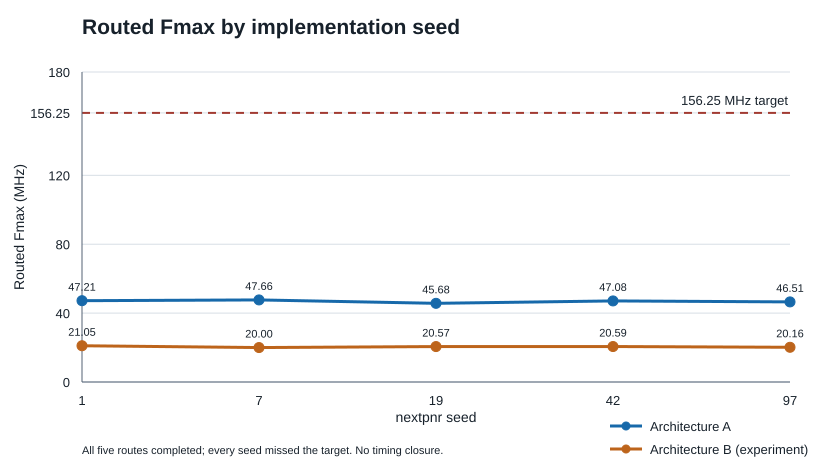

# Wire-to-Decision

Wire-to-Decision is a SystemVerilog FPGA portfolio project that turns a framed post-MAC Ethernet stream into a deliberately simple BUY/SELL decision event. It covers protocol parsing, ready/valid flow control, bounded order state, deterministic decisions, formal checks, ECP5 implementation and reproducible software checking.

The implemented profile is intentionally narrow: Ethernet II carrying fixed-profile IPv4/UDP, MoldUDP64 framing, and TotalView-ITCH A/F/E/C/X/D/U mutations plus P as non-mutating traffic. It tracks one configured stock locate in a 512-set × 2-way order store. It is not a live market-data client or production trading system.

## Datapath

```mermaid
flowchart LR
    RX["64-bit post-MAC interface<br/>data / keep / valid / ready / last"]
    subgraph A["Architecture A — selected single-clock baseline"]
        RX --> IB["2-beat ingress buffer"]
        IB --> GB["64-to-8 gearbox"]
        GB --> ETH["Ethernet II"]
        ETH --> IP["IPv4"]
        IP --> UDP["UDP"]
        UDP --> MOLD["MoldUDP64 header and message framing"]
        MOLD --> ITCH["ITCH subset decoder"]
        ITCH --> EVT["Normalized mutation event"]
        EVT --> BOOK["512 × 2 order store"]
        BOOK --> AGG["48-bit bid / ask totals"]
        AGG --> DEC["Threshold and risk budget"]
        DEC --> OUT["Ready/valid decision"]
    end
    RXBEATS["RX-domain framed beats"] --> AFIFO["WIRE-029 8 × 73-bit async FIFO"]
    RXCLK["rx_clk"] -.-> AFIFO
    PROC["proc_clk"] -.-> AFIFO
    AFIFO -->|"proc_clk stream"| RX
```



Architecture A is byte-serial after the 64-bit ingress buffer: each protocol stage handles one byte at a time, keeping header and boundary state straightforward while preserving natural ready/valid backpressure. Packet-final markers travel with the byte stream. WIRE-029 adds an optional two-clock FIFO wrapper before the same functional top; it does not change the single-clock baseline or its A/B measurements.

## Design choices and measured trade-offs

- The parser is a small fixed-profile pipeline rather than a programmable parser. It validates outer framing before exposing normalized ITCH events.
- The order store uses the frozen WIRE-D006 XOR-fold hash, deterministic two-way allocation and no eviction. Each mutation updates the selected row and bid/ask aggregate through a successful commit boundary. The decision engine evaluates only successful commits; a qualifying threshold crossing consumes one budget credit when its ready/valid decision is created.
- The initial full-capacity synthesis mapped too much order data into LUT RAM and did not fit. WIRE-026A changed the store to synchronous packed-row access, mapping the 1,024-entry data to 16 EBRs. WIRE-027 registered the validated write plan between row evaluation and writeback. The critical endpoint moved from memory write data to registered write-plan control, and routed Fmax improved; timing still missed the objective.
- WIRE-028's initial eight-lane parser became impractical in Yosys FSM extraction. The final bounded experiment used a two-byte-per-cycle direct-beat parser with the same book and decision logic. It processed more bytes per simulation cycle, but used nearly twice the LUT4s and routed at a lower clock frequency. Architecture B was rejected for this baseline; Architecture A remains selected. The earlier failed synthesis logs remain under `results/raw/implementation/arch_b/`.
- The CDC FIFO uses Gray-coded pointers, two-stage synchronizers and an explicit epoch/rearm handshake. Simulation and local bounded checks do not establish physical metastability performance or Gray-bus skew compliance.

## FPGA implementation comparison

Both designs used the frozen LFE5U-85F-8BG381C target, five seeds (`1, 7, 19, 42, 97`) and a 156.25 MHz objective. The table reports Yosys `synth_ecp5` resources and the routed Fmax range from the saved nextpnr runs.

| Design | Role | Yosys LUT4 | FF | EBR | Routed Fmax, five seeds |
|---|---|---:|---:|---:|---:|
| Architecture A | Selected baseline | 7,376 | 3,943 | 16 | 45.68–47.66 MHz |
| Architecture B | Two-byte parser experiment; rejected | 14,559 | 3,700 | 16 | 19.997–21.047 MHz |



Figure inputs, hashes and regeneration command are recorded in [image provenance](images/PROVENANCE.md).

All ten builds routed, and every seed missed 156.25 MHz. The chart is generated from the committed per-seed CSVs. Cocotb measurements showed A at 0.862–0.958 accepted bytes/cycle and B at 1.724–1.909 on matched workloads. The rates calculated using each design's conservative minimum routed Fmax were lower for B. These are derived estimates, not physical throughput. Cycle latency and derived rates are defined in the [WIRE-028 report](results/processed/WIRE-028-architecture-ab-comparison.md); no physical FPGA operation, physical latency or timing closure is claimed.

On the matched simulation workloads, end-to-end cycles for A/B were 116/58 (single ADD), 146/75 (two messages), and 697/350 (stateful seven-message stream). L1 is first ITCH message byte accepted to normalized-event valid; L2 is the final mutation-determining byte accepted to `decision_valid`; L3 is the first external frame beat accepted to `decision_valid`. Tests use no-stall legal traffic and a ready decision consumer. These are simulation-cycle measurements, not wall-clock or physical measurements. The workload table and accepted-byte/cycle method are in the linked report.

The timing experiment also separated two bottlenecks: A's routed critical path was in the EBR-backed order-book read/update logic, while B's was in ingress selection and parser control. The B result is limited to this tested architecture and workload; it does not prove that all possible parallel parsers are inferior.

## Verification

The [Python model](model/python/wire_to_decision/) is a functional reference. Cocotb checks RTL behavior at module and full-top ready/valid boundaries. SBY/Yices checks named local properties under recorded reset, input-stability, fixed-vector or reduced-instance assumptions; they are bounded checks, not a whole-design proof. The project-original [C++20 checker](tools/cpp/) independently derives decisions from packet replay bytes and compares them with logs exported by actual RTL simulation.

Recorded results include Python **71/71**, WIRE-025 **109/109 Cocotb tests** and **79 executed bounded/fixed/reduced formal jobs**, and WIRE-030 **15 C++ fixtures**. The canonical replay drives four complete post-MAC frames through the actual functional top: C++ compared three Mold messages and two RTL decisions with zero mismatches. A deliberately corrupted decision log is detected. WIRE-030 also reran the documented Python, C++, RTL replay, functional-top and representative formal commands from a clean clone. See the [evidence index](docs/EVIDENCE_INDEX.md) and [WIRE-030 report](results/processed/WIRE-030-cpp-and-closeout.md).

## Reproduce representative checks

Use the qualified OSS CAD Suite. Set `WIRE_TO_DECISION_OSS_CAD_SUITE` if it is installed outside the default location configured by the repository script.

```bash
source tools/env/setup_oss_cad_suite.sh
set -e

PYTHONPATH=model/python python3 -m unittest discover -s model/python/tests -v
make -C tools/cpp clean test

# Cocotb uses a lib symlink to the qualified suite; remove it after each run.
run_cocotb() {
  local test_dir="$1"
  ln -s "$WIRE_TO_DECISION_OSS_CAD_SUITE/lib" "$test_dir/lib"
  local result=0
  if (cd "$test_dir" && make clean && make SIM=verilator); then
    result=0
  else
    result=$?
  fi
  unlink "$test_dir/lib"
  return "$result"
}

run_cocotb tb/cpp_replay
tools/cpp/build/w2d_checker compare \
  tools/cpp/replays/canonical.w2d \
  results/raw/cpp/rtl_decisions.log results/raw/cpp/summary.json
run_cocotb tb/functional_mvp
(cd formal/decision_engine && sby -f decision_reference.sby)
```

The replay format and measurement boundaries are documented in [WIRE-030](tasks/WIRE-030.md). The saved full implementation commands are [`synthesis_command.txt`](results/raw/implementation/wire027/synthesis_command.txt) and [`pnr_command.txt`](results/raw/implementation/wire027/pnr_command.txt); the [WIRE-027 report](results/processed/WIRE-027-bottleneck-experiment.md) and [WIRE-028 report](results/processed/WIRE-028-architecture-ab-comparison.md) link the complete retained reports. Reproducing those campaigns is not needed for the quick-start checks.

The work used the qualified open-source EDA/verification toolchain and AI-assisted planning, review and implementation. No claim of exclusively manual authorship is made. The [third-party manifest](docs/THIRD_PARTY_MANIFEST.md) records reference projects; no third-party datapath RTL is a project dependency.

## Repository map

- [`rtl/arch_a/`](rtl/arch_a/) and [`rtl/common/`](rtl/common/): parser, functional top, order book, decision engine and CDC wrapper.
- [`tb/`](tb/): Cocotb module and integration tests; [`formal/`](formal/): SBY harnesses and jobs.
- [`model/python/`](model/python/) and [`tools/cpp/`](tools/cpp/): reference model and independent replay checker.
- [`results/processed/`](results/processed/): concise task reports; [`results/raw/`](results/raw/): tool logs, CSVs and implementation reports.
- [`docs/PROJECT_STATE.md`](docs/PROJECT_STATE.md), [`docs/DECISIONS.md`](docs/DECISIONS.md), [`docs/EVIDENCE_INDEX.md`](docs/EVIDENCE_INDEX.md): current status, frozen decisions and evidence traceability.

## Limits

The 156.25 MHz target remains unmet. No physical FPGA run, board pinout, package I/O timing validation, physical latency/throughput measurement or commercial CDC/RDC signoff was performed. Formal evidence is bounded or fixed/reduced-scope where stated; historical solver-bound jobs remain unresolved. The design has no live exchange connection or trading functionality.
